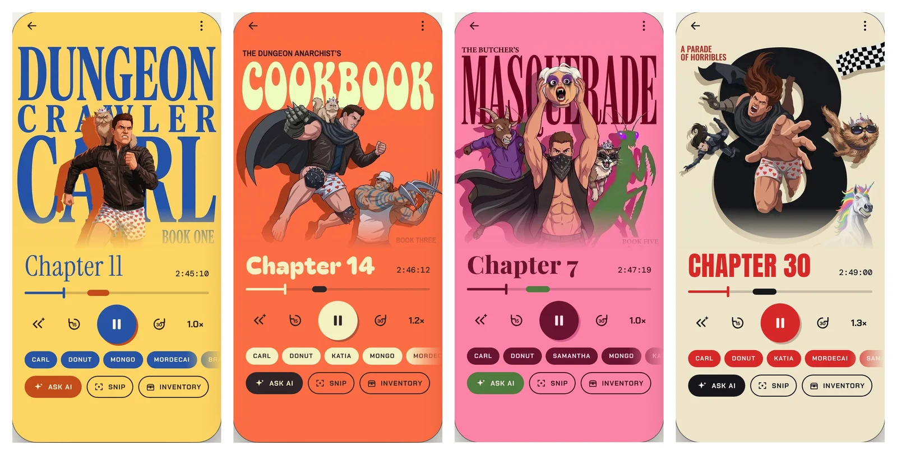
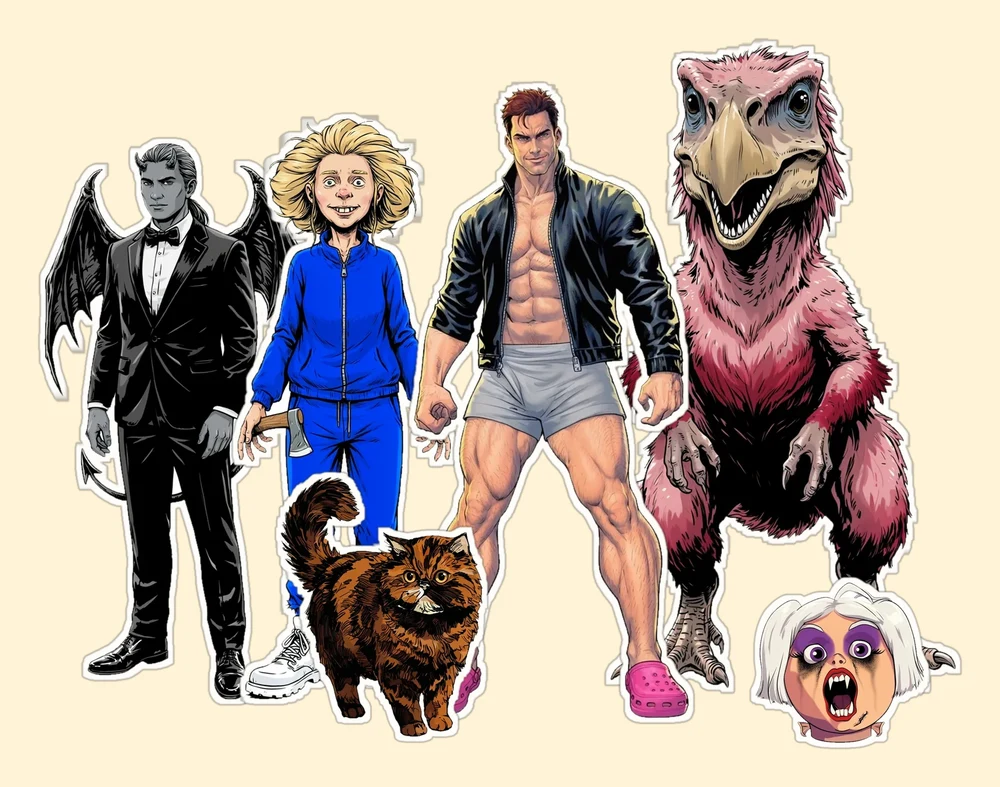
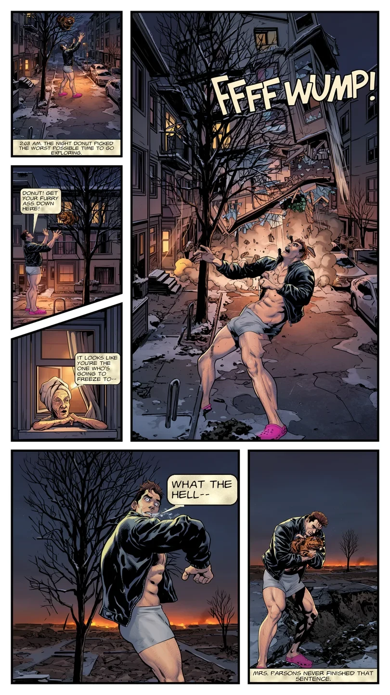

# The Crawl

**An audiobook player that listens along with you.** Built for the *Dungeon Crawler Carl* series, The Crawl turns a plain audiobook into a
companion experience: ask the story a question without taking your hands off the wheel, see who is in the scene, collect character cards that
level up as the book goes on, and turn big moments into comic strips.

<p align="center">
  
</p>

<sub>Design renders of the player for Books 1, 3, 5 and 8. Every book gets its own colors and poster-style cover.</sub>

## The experience

You press play and listen like normal. When a name slips past you or you lose the thread, the co-pilot is one button away. It answers from
what you have actually heard, so it never spoils what comes next.

### Ask the book

Press **Ask AI** on screen or use your headset buttons, then speak or type. "Who is Mongo again?", "Why is Donut angry?", "What just happened?"
The answer streams in and can be read aloud in a voice with the System AI's attitude. Questions are answered from the transcript up to
where you are, so there are no spoilers. A short musical loop plays while it thinks.

- **Catch me up** recaps the last stretch, or the end of your previous session when you have just come back to the book.
- **Auto-identify** names whoever or whatever was just mentioned and gives a two sentence refresher.
- **System AI chat** opens as a bottom sheet with the microphone already listening. Stop talking and it sends after five seconds.
- Every question and answer is kept, and any reply can be played again.

### Headset buttons

The co-pilot works with the buttons on your earbuds, so your phone can stay in your pocket or in the car.

| Press | Does |
| --- | --- |
| Next, once | Open mic: ask a question |
| Next, twice | Auto-identify what you just heard |
| Next, three times | Your choice (set in Settings) |
| Previous, twice | Catch me up |
| Previous, once | Rewind 15 seconds |
| Play/Pause | Cancels the co-pilot and goes straight back to the book |

### X-Ray

Chips along the player show who is in the scene right now, such as Carl, Donut, Mongo and Mordecai. Tap one for a quick, spoiler-safe refresher on that
character. Chips appear only while a character is actually in the scene.

### Holo cards and The Deck

Carl, Donut, Katia and Mordecai get collectible cards with level, floor, race, class, stats, skills and gear. They keep up with the story, so
the card for Carl in Book 1 is not the card for Carl in Book 4. Cards you have unlocked live in **The Deck**.

<p align="center">
  
</p>

<sub>Character art used for X-Ray and the cards.</sub>

### Snip and Strips

Hit **Snip** when something great happens. The Crawl saves the line, links it back to the exact moment in the audio, and draws a comic frame
for it. Key chapters get full comic **Strips** that you can flip through in the Notebook. Strips for all ten chapters of Books 1 and 2 are done.

<p align="center">
  
</p>

<sub>The Chapter 1 strip, exactly as it is drawn for the app.</sub>

### Every book looks different

Each of the eight books has its own player: a poster cover redrawn for the app, its own colors, fonts and controls, and a library that fans
your books out as a card stack that tilts as you scroll. Your **Inventory** sheet keeps your snips and cards close at hand.

### Android Auto

In the car, the big buttons are Play, Ask and Snip on the left and Recap, Back 15 and Forward 30 on the right, in the same colors as the
app.

## What's in the box

- A full audiobook player: M4B and MP3 files, chapters, bookmarks, sleep timer, speed control and resume. This is [Voice](https://github.com/PaulWoitaschek/Voice) underneath.
- The AI co-pilot: ask, recap, auto-identify and snip, by touch, by voice or by headset.
- X-Ray chips, holo cards, The Deck and comic Strips for the books that have them.
- Eight per-book player designs.

## How it knows the story

The Crawl listens to nothing. Each book has a transcript file next to the audio, made once on a computer, and the co-pilot reads only the part
you have already heard. Questions, together with the recent lines of transcript, go to Google's Gemini and the answer comes back to the
phone. Spoken replies are generated with Fish Audio. Your library and listening position stay on the device.

Put a book and its files in the same folder:

```
1. Dungeon Crawler Carl.m4b
1. Dungeon Crawler Carl.json         transcript
1. Dungeon Crawler Carl.xray.json    who is in the scene, and when
1. Dungeon Crawler Carl.cards.json   holo card timeline
```

Without the extra files it is still a very good audiobook player. The co-pilot, X-Ray and cards switch on when the files are there.

## Status

The Crawl is a personal Android app, not on Google Play. It is built from this repository and installed straight onto a phone. Books 1 to 8 of
Dungeon Crawler Carl are on the phone with transcripts and their own player designs. Strips are finished for Books 1 and 2 and planned for the rest.

Developer notes for this repository are in [`AGENTS.md`](AGENTS.md) and [`docs/architecture.md`](docs/architecture.md). The Android package
name is still `de.ph1b.audiobook`.

## Credits and license

The Crawl is a fork of [Voice](https://github.com/PaulWoitaschek/Voice) by Paul Woitaschek and its contributors, and keeps its
[GPLv3 license](LICENSE.md). *Dungeon Crawler Carl* is by Matt Dinniman; this is an unofficial fan project for personal use. Cover and
character art is generated for the app.
